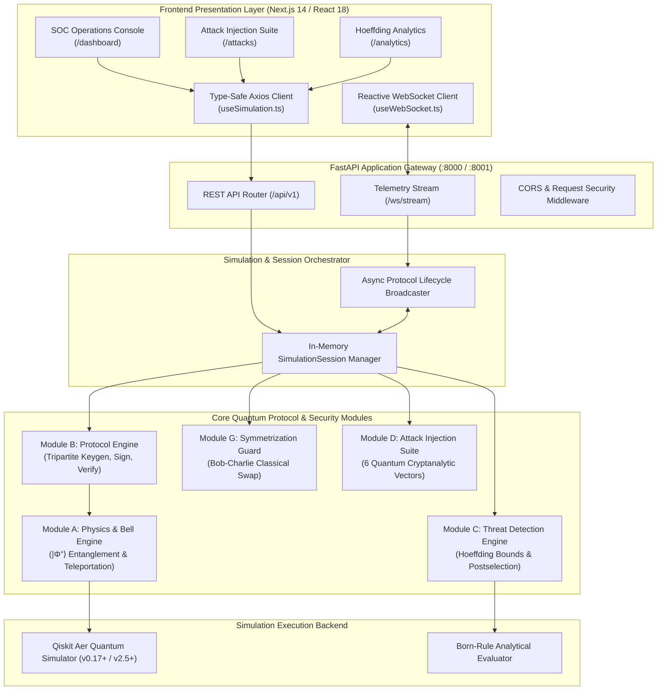
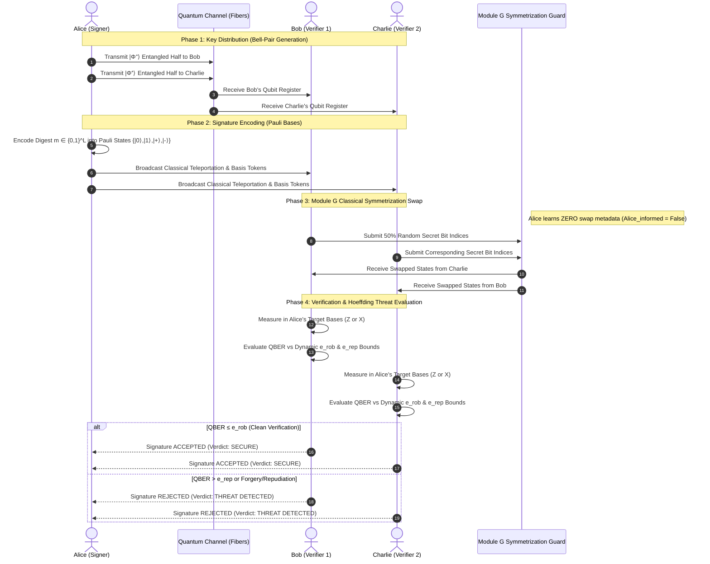
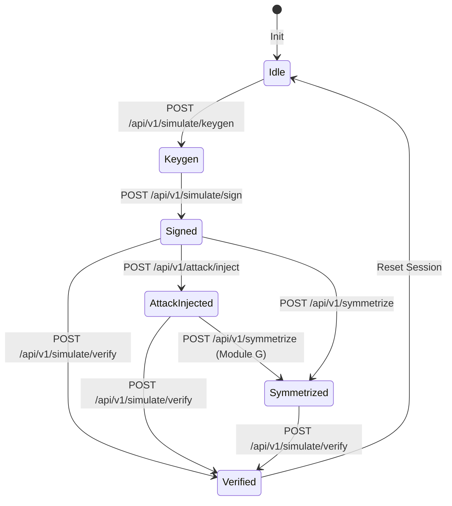

# Quantum Digital Signatures (QDS) System Architecture

This document details the architectural blueprints, protocol sequence specifications, and deterministic threat detection pipelines for the **Quantum Digital Signatures (QDS) Threat Detection Engine**.

---

## 1. High-Level System Component Architecture

The system is structured as a decoupled, multi-tier reactive stack operating under a strict **Zero-AI/ML deterministic security standard**.



---

## 2. Tripartite QDS Protocol & Symmetrization Sequence

The protocol distribution sequence demonstrates the transmission of EPR states from Alice to Bob and Charlie, followed by the classical encrypted symmetrization swap (Module G) that guarantees verifier agreement and eliminates dishonest-signer repudiation.



---

## 3. Zero-ML Threat Detection Engine Pipeline (Module C)

All detection logic is deterministic, backed by Hoeffding's finite-key concentration inequality and counterfactual physical measurements. No machine learning models, statistical heuristics, or non-deterministic classifiers are permitted.

```mermaid
flowchart TD
    IN[Incoming Verifier Quantum States & Classical Packet] --> PS[Layer 1: Boundary Postselection Filter]

    PS -->|Discard Ambiguous Shots| REJ[Discarded Buffer (e.g. 123 Shots)]
    PS -->|Retain Confident Shots| DUAL[Layer 2: Dual-Path MDI Detector Cross-Check]

    DUAL --> PATH_A[Path A: Primary Homodyne Channel]
    DUAL --> PATH_B[Path B: Counterfactual Zero-Transmission Monitor]

    PATH_A --> BIAS_CHK{Path A vs Path B Disagreement > Margin?}
    PATH_B --> BIAS_CHK

    BIAS_CHK -->|Yes: Blinding Detected| BLIND_ALERT[Flag ERR_DETECTOR_SIDE_CHANNEL_BIAS<br/>Severity: CRITICAL]
    BIAS_CHK -->|No: Symmetrical| STATS[Layer 3: Quantum Error & Credential Evaluation]

    STATS --> KEY_CHK{Signer Public Key == Authorized Alice?}
    KEY_CHK -->|Mismatch| IMP_ALERT[Flag ERR_SIGNER_IDENTITY_MISMATCH<br/>Severity: HIGH]
    KEY_CHK -->|Match| REPLAY_CHK{Nonce Fresh & Timestamp < Window?}

    REPLAY_CHK -->|Stale / Reused| REP_ALERT[Flag ERR_REPLAY_STALE_OR_DUPLICATE_NONCE<br/>Severity: HIGH]
    REPLAY_CHK -->|Valid Nonce| H_EVAL[Layer 4: Hoeffding Bound Evaluator]

    H_EVAL --> CALC_BOUNDS["Compute Dynamic Bounds:<br/>e_rob = δ + sqrt(ln(1/ε) / 2n)<br/>e_rep = e_rob + margin<br/>e_forg = 2 * e_rob + margin"]

    CALC_BOUNDS --> FORG_CHK{Tampered Digest Disagreement > e_forg?}
    FORG_CHK -->|Yes| FORG_ALERT[Flag ERR_PAYLOAD_FORGERY_DETECTED<br/>Severity: HIGH]
    FORG_CHK -->|No| QBER_CHK{Measured QBER > e_rep?}

    QBER_CHK -->|Yes: Eavesdropping| EAVE_ALERT[Flag ERR_HOEFFDING_QBER_ANOMALY<br/>Severity: CRITICAL]
    QBER_CHK -->|No| SYM_CHK{Verifier Block Divergence > e_rep?}

    SYM_CHK -->|Yes: Repudiation Intercepted| REPUD_ALERT[Flag ERR_HOEFFDING_REPUDIATION_BOUND_BREACH<br/>Severity: CRITICAL]
    SYM_CHK -->|No: QBER ≤ e_rob| CLEAN_PASS[VERDICT: SECURE<br/>Confidence > 99.9%<br/>Severity: LOW]

    BLIND_ALERT --> AGG[Verdict Assembler]
    IMP_ALERT --> AGG
    REP_ALERT --> AGG
    FORG_ALERT --> AGG
    EAVE_ALERT --> AGG
    REPUD_ALERT --> AGG
    CLEAN_PASS --> AGG

    AGG --> OUT[Generate VerifyResponse & Broadcast Live Telemetry Frame]
```

---

## 4. Finite State Machine: Session Lifecycle


